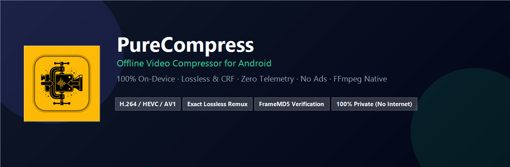

<div align="center">



# PureCompress (Video Compress for Android)

**100% On-Device, Privacy-First, Zero-Telemetry Video Compressor for Android.**  
*Powered by Flutter & Native FFmpeg (Full GPL Build)*

[](https://developer.android.com)
[](https://flutter.dev)
[](https://ffmpeg.org)
[](LICENSE)
[](https://github.com/arybishal/Video-Compress-for-Android/releases)

---

</div>

## 📌 Overview

**PureCompress** is an open-source, fully offline video compression and transcoding utility built for Android. Unlike ordinary mobile video compressors, PureCompress **never connects to the internet**, **never shows advertisements**, **never collects user data**, and **never claims to be lossless unless mathematically verified**.

Every compression operation happens completely locally on your device using a high-performance native FFmpeg engine (GPL full build supporting `libx264`, `libx265`, `libaom-av1`, and Android MediaCodec hardware acceleration).

---

## ✨ Features

- 🔒 **100% Private & Offline**: Zero internet permissions (`android.permission.INTERNET` is not even declared). Your files never leave your device.
- 📐 **Aspect Ratio & Resolution Control**:
  - **Aspect Ratios**: Original, 9:16 Portrait, 16:9 Landscape, 1:1 Square, 4:5 Portrait Social, 3:4 Portrait, 4:3 Landscape, and Custom Ratios.
  - **Resolution Presets**: Original, 4K (3840×2160), 3.5K (3440×1440), 2K (2560×1440), Full HD (1920×1080), HD (1280×720), SD (854×480), 1080×1920 Portrait, 720×1280 Portrait, and Custom Dimensions.
  - **Framing & Fit Modes**: *Fit with Padding* (letterbox/pillarbox safe mode), *Crop to Fill* (center crop), *Stretch to Fill*, and *Preserve Original*.
  - **Interactive Geometry Card**: Real-time side-by-side comparison of source media dimensions/aspect ratio vs. target output dimensions and framing tags.
- 📱 **One-Tap Social Media Presets**: Instant vertical framing presets for TikTok, Instagram Reels, YouTube Shorts, Facebook Reels, and General Vertical Video.
- 🌈 **Global HDR & Color Processing**:
  - **Off**: Accurate color preservation.
  - **HDR Effect**: Cinematic perceptual dynamic range enhancement with adjustable intensity slider (contrast, brightness, vibrancy without highlight clipping).
  - **SDR to HDR10**: True HDR10 encoding with BT.2020 color space, SMPTE 2084 (PQ) transfer characteristics, and HDR metadata.
- 🎯 **Exact Lossless Remuxing**: Stream-copy videos without re-encoding (`-c copy`) in seconds.
- 🔬 **Decoded-Frame Fingerprinting (FrameMD5)**: Exact Lossless modes verify decoded frame equality against the source using MD5 hash sequences rather than guessing from return codes.
- ⚡ **High Efficiency (CRF Mode)**: High visual fidelity with real Constant Rate Factor rate control for H.264, HEVC / H.265, and AV1.
- 💾 **Custom Preset Manager**: Save custom parameter combinations as reusable named presets, switch profiles effortlessly, and manage custom workflows.
- 🛠️ **Custom Mode**: Fine-grained control over resolution, frame rate, audio codecs (AAC / Opus / Passthrough), bitrate, and container (MP4 / MKV).
- 🛡️ **Zero Destructive Actions**: Original videos are strictly read-only and never deleted or overwritten.
- 📊 **Honest Metrics**: Clear progress reporting with true byte-for-byte delta calculations (honestly shows positive or negative savings).
- 🚀 **Hardware + Software Hybrid**: Auto-detects Android MediaCodec hardware encoders and falls back to CPU encoding when quality or CRF is required.

---

## ⚙️ How Does PureCompress Work?

PureCompress bridges Flutter's reactive UI with a native Android FFmpeg execution pipeline:

```
[ User Video Selection ] 
         │ (SAF / Photo Picker URI)
         ▼
[ Private Cache Staging ] (Scoped Storage safe, /cache/purecompress_pick/)
         │
         ▼
[ MediaProbe (ffprobe) ] (Inspects streams, codecs, bitrates, dimensions, color profiles)
         │
         ▼
[ Settings & Capability Validation ] (Enforces compatible codec/container combinations)
         │
         ▼
[ JobPlanner ] (Generates sanitized, deterministic FFmpeg argument pipelines)
         │
         ▼
[ Native FFmpegKit Execution ] (Full GPL native thread, completed callback handling)
         │
         ▼
[ Verification & Integrity Analysis ] (FrameMD5 comparison for lossless; integrity check for lossy)
         │
         ▼
[ Export / MediaStore Publication ] (Atomic copy to Movies/PureCompress or SAF destination)
```

### The Three Compression Modes

1. **Exact Lossless**:
   - **Stream Copy (`copy`)**: Remuxes existing audio/video streams without re-encoding. Bit-identical stream content; fast and zero quality degradation.
   - **Lossless Re-encode**: Mathematically lossless re-encoding via `libx264` (`-crf 0`), `libx265` (`lossless=1`), or `libaom-av1` (`-lossless 1`).
2. **High Efficiency**:
   - **High Quality**: CRF 18 (near-indistinguishable from source).
   - **Balanced**: CRF 23 / 26 (recommended balance of size and visual quality).
   - **Smaller File**: High compression for sharing via chat or email.
3. **Custom**:
   - Manually customize Codec, Bitrate, Resolution (4K, 1080p, 720p, 480p), FPS, Audio strategy, and Container format.

---

## 📱 Requirements

### For End Users
- **OS**: Android 7.0 (Nougat, API 24) or newer.
- **Recommended**: Android 10+ (API 29+) with 64-bit ARM (`arm64-v8a`) architecture.
- **Storage**: Sufficient free internal storage for staging the processed video.

### For Developers & Building from Source
- **Flutter SDK**: 3.47.x (Stable)
- **Dart SDK**: 3.10+
- **Android SDK**: API 36+ (Build-Tools 36.0.0+)
- **JDK**: Java Development Kit 17+
- **Host OS**: Windows, macOS, or Linux

---

## 📥 Installation

### Option 1: Install Pre-Built APK (Recommended)
1. Download the latest `app-debug.apk` or release APK from the [**Releases Page**](https://github.com/arybishal/Video-Compress-for-Android/releases).
2. On your Android device, tap the downloaded APK file.
3. If prompted, enable **"Install Unknown Apps"** for your browser or file manager.
4. Tap **Install** and launch **PureCompress**.

### Option 2: Build from Source

```bash
# 1. Clone the repository
git clone https://github.com/arybishal/Video-Compress-for-Android.git
cd Video-Compress-for-Android

# 2. Fetch Flutter dependencies
flutter pub get

# 3. Connect your Android device or start an emulator
flutter devices

# 4. Run tests
flutter test

# 5. Build Debug APK
flutter build apk --debug

# Or build Release APK
flutter build apk --release
```

The resulting package will be generated at:
`build/app/outputs/flutter-apk/app-debug.apk`

---

## 🏷️ Tags & Topics

`android` · `video-compression` · `ffmpeg` · `flutter` · `aspect-ratio` · `resolution-presets` · `hdr` · `h264` · `hevc` · `h265` · `av1` · `lossless` · `privacy` · `offline-first` · `mediacodec` · `dart`

---

## 📄 License

This project is licensed under the **GNU General Public License v3.0 (GPL-3.0)** due to bundling native FFmpeg full-GPL libraries. See [LICENSE](LICENSE) and [DEPENDENCIES_AND_LICENSING.md](docs/DEPENDENCIES_AND_LICENSING.md) for full terms.
